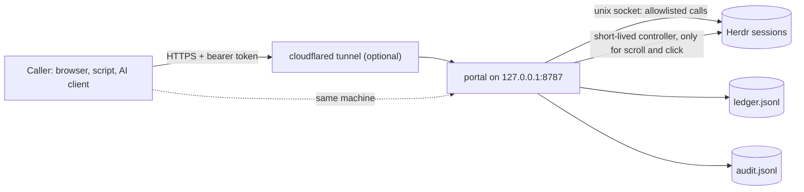

# Instinct Herdr Tunnel

**A guarded bridge from your phone or AI assistant to the coding agents in [Herdr](https://herdr.dev).** Read an agent's whole chat, send it a prompt, scroll and click inside your panes: through 26 allowed actions, a bearer token and an audit log. Built so an AI assistant such as [Instinct](https://instinct.com) can watch and nudge your agents; any caller that can send an HTTPS request with a bearer token can use it. An independent community project: not affiliated with, endorsed by or sponsored by Instinct or Herdr.

  [](https://github.com/romiluz13/instinct-herdr-tunnel/actions/workflows/test.yml)  

Herdr's socket API has 102 request methods; some close panes, stop the server or run plugins. A phone or an AI assistant that needs to *see* your agents and *nudge* them should not hold that power. The portal sits in front of Herdr and offers 26 actions, each with strict parameters. History reads, scroll and click are extra, **off until you switch them on**, and a click only lands if the text the caller expects is still under it. With no switch on, whoever holds the token can still prompt agents and type a command line into a shell pane, so treat the token like a shell ([security model](docs/security.md)).

A blocked agent is waiting on a permission dialog and a caller pushes it along. From the test suite's fake Herdr, abridged, with the HTTP status shown as a field ([full output](docs/see-it-work.md)):

```text
# prompt a BLOCKED agent
{ "http": 409, "error": { "code": "blocked_requires_decision", "agent_status": "blocked" } }

# answer its dialog with agent_decision (default config)
{ "http": 404, "error": { "code": "action_disabled" } }

# keys the fake Herdr received for those two calls
[]
```

## Quickstart

macOS. You need Node.js 22 or newer, git and [Herdr](https://herdr.dev/docs/install/) running (proven live on 0.9.5). No npm dependencies.

```sh
git clone https://github.com/romiluz13/instinct-herdr-tunnel.git && cd instinct-herdr-tunnel

# 1. the portal as a per-user service on 127.0.0.1:8787: checks everything first, writes nothing if a check fails
HERDR_PORTAL_ENABLE_HISTORY=agents CLOUDFLARED_BIN=none bin/portalctl install
bin/portalctl status

# 2. optional: the Herdr plugin (a live activity tab, Agents-view actions)
herdr plugin install romiluz13/instinct-herdr-tunnel/plugin
```

Your first calls (`session=default` is Herdr's default session):

```sh
TOKEN=$(cat "$HOME/Library/Application Support/herdr-portal/secrets/portal-token")
curl -s -H "Authorization: Bearer $TOKEN" http://127.0.0.1:8787/api/health
curl -s -H "Authorization: Bearer $TOKEN" "http://127.0.0.1:8787/api/herdr/agent_list?session=default"
# the whole chat of one idle or done agent (take pane_id from agent_list)
curl -s -H "Authorization: Bearer $TOKEN" "http://127.0.0.1:8787/api/herdr/pane_read?session=default&pane_id=w1:p2&source=recent_unwrapped&lines=2000"
```

Open `http://127.0.0.1:8787/` for the browser UI. Sign in with the token: `bin/portalctl token-copy` puts it on the clipboard for 60 seconds without printing it.

- **`CLOUDFLARED_BIN=none` keeps the portal reachable from this Mac only.** Without it, `install` also adds a Quick Tunnel job whenever `cloudflared` is on your `PATH`, and that public address is reachable by anyone who has it. With `none` the installer prints "cloudflared not found": expected. A tunnel job installed earlier stays loaded. To reach the portal from another device, read [the tunnel guide](docs/tunnel.md) first.
- **More power, on purpose.** Install again with the switches you want; the service keeps only the ones set at install time:

  ```sh
  HERDR_PORTAL_ENABLE_HISTORY=all HERDR_PORTAL_ENABLE_CONTROL=1 HERDR_PORTAL_TAG_PANES=1 CLOUDFLARED_BIN=none bin/portalctl install
  ```

  `all` adds plain shells' scrollback, where keys and tokens may sit. `CONTROL=1` turns on scroll and click, which [control](docs/control.md) advises only behind something that authenticates people. `TAG_PANES=1` sets the pane tag. Agent click (`HERDR_PORTAL_ENABLE_AGENT_CLICK=1`) and [`agent_decision`](docs/agent-decision.md) stay off until you have read why.

<details>
<summary>Linux, or no LaunchAgent: run the server in a terminal</summary>

Developed and tested on macOS; the server uses only Node's standard library and Unix sockets. No real Herdr was run on Linux or Windows (CI runs the suite on Linux against fakes).

```sh
npm test                   # the suite, against fakes; touches no real pane
# create the token (32 random bytes, file mode 0600, never printed; run it once, it replaces an existing token), then start the server
node -e 'require("./lib/config").ensureDirs(); require("./lib/security").createToken()'
HERDR_PORTAL_ENABLE_HISTORY=agents node server.js    # listens on 127.0.0.1:8787; `herdr` must be on PATH, or set HERDR_BIN
```

Run the calls above in a second terminal. The token is under `HERDR_PORTAL_STATE_DIR`, by default `~/Library/Application Support/herdr-portal` on every OS ([configuration](docs/configuration.md)).
</details>

## See it work

`node scripts/e2e-control.js` starts its own Herdr server and portal in a temporary home, so it never touches your sessions, and drives them through the HTTP API. This is a real run on Herdr 0.9.5, recorded as it happened:


What this run does *not* prove is listed in [See it work](docs/see-it-work.md#read-scroll-and-click-on-a-real-herdr).

## What you get

- 🔭 **Whole-chat history.** `pane_read` with `source=recent_unwrapped` returns the last 1000 rows of an idle agent's chat (Herdr 0.9.5 stops there; checked live on agents of the kinds claude, codex and droid; the read makes Herdr [page that agent briefly](docs/security.md#residual-risks)) and up to 2000 lines of a plain pane's scrollback (that needs `HERDR_PORTAL_ENABLE_HISTORY=all`). It says how complete the answer is (`history_mode`, `lines_returned`, `truncated`); "nothing beyond the screen" is a typed answer (`409 history_unavailable` with the screen attached), never an empty success. A browser page shows the same: a live view, history with *Load more*, scroll buttons, a click mode. *Proof:* `tests/history.test.js` on a fake Herdr, the plain-shell step in the recording above, and the by-hand agent reads listed under [not covered](docs/control.md#not-covered).
- 🕹️ **Scroll, click, prompt.** `pane_scroll` moves Herdr's own scrollback or sends wheel events to a full-screen app; on an agent's pane it is refused (`409 use_history_read`): read its history instead. `pane_click` clicks one cell, only if the text the caller expects is still under it, and refuses, sending nothing, rows that look like a dialog choice or hold a confirm or refuse word ([pattern matching, not a guarantee](docs/control.md#click)), cells it cannot map and a terminal whose size it cannot confirm. `agent_prompt` accepts a working agent and answers `input_sent_queued`: delivered, and the agent's own interface decides whether it queues it. *Proof:* `tests/control.test.js`, `tests/click.test.js`, `tests/prompt-queue.test.js`, the recording above.
- 🛡️ **A short allowlist.** Unknown actions and parameters are refused. Every write that sends input to a pane, except `agent_decision`, refuses a blocked agent and sends nothing; `agent_decision`, the action meant to answer a dialog, is off by default ([why](docs/agent-decision.md)). Writes are replay-safe and each leaves a line in `audit.jsonl` (a call to a switched-off action leaves none). The main gap: a prompt to a *working* agent can land on a dialog the portal does not recognize, or one raised just before Herdr marks the agent blocked, and its Enter can pick the highlighted option ([residual risks](docs/security.md#residual-risks), which lists the others). *Proof:* `tests/portal.test.js` (blocked refusal, replay, crash, audit); the [proof matrix](docs/proof-matrix.md) checks the action names against Herdr's schema.
- 🧩 **Inside Herdr.** With `HERDR_PORTAL_TAG_PANES=1` the portal sets a display-only tag on each pane it sends, or may have sent, input to (`prompt sent 14:07`); add `$tunnel_last` to a row of Herdr's sidebar to see it ([how](docs/plugin.md#turn-the-tag-on); how the drawn row looks was not checked). The [plugin](docs/plugin.md) adds a live activity tab and Agents-view actions that narrow the list to the agents the portal touched. The tab's header shows the tunnel's state; that header is on `main`, newer than the `v0.1.0` pre-release. Neither the tag nor the plugin can send input to a pane. *Proof:* `node scripts/e2e-plugin.js` against a real Herdr in a throwaway home (tag and plugin); `tests/plugin-feed.test.js` (the tunnel header).
- 🌍 **Reach and diagnose.** `portalctl install` can add a Quick Tunnel job (see the first note above); a named Cloudflare tunnel with Access in front is a [guide](docs/tunnel.md) you follow yourself, not tested here. `bin/portalctl diagnose` is a read-only report: whether the portal answers, how many connections the tunnel has, and each outage in the last 24 hours. It is on `main`; the `v0.1.0` pre-release predates it. `portalctl` also rotates the token and revokes access. *Proof:* `tests/diagnose.test.js`, for `diagnose` only.

## How it fits together



## Docs

| | |
|---|---|
| [API reference](docs/api.md) | endpoints, the 26 actions, errors, write semantics |
| [For an AI assistant](docs/client-guide.md) | connect, see, act and check, in order |
| [Control: history, scroll, click](docs/control.md) | the model, the limits, what was not measured |
| [Herdr plugin and pane tag](docs/plugin.md) | install, the sidebar row, what it can and cannot do |
| [Security model](docs/security.md) | what the token can do, what is and is not protected |
| [Configuration and service](docs/configuration.md) | environment variables, `portalctl`, a second instance |
| [Reaching it remotely](docs/tunnel.md) | Cloudflare Quick Tunnel, a named tunnel, Access in front |
| [`agent_decision`](docs/agent-decision.md) | the action meant to answer a dialog, and why it is off |
| [See it work](docs/see-it-work.md) | a blocked agent on a fake Herdr, a run on a real one, and the commands that check the numbers |
| [Proof matrix](docs/proof-matrix.md) · [Tests](docs/development.md) | how each claim is checked |
| [Glossary](GLOSSARY.md) · [Changelog](CHANGELOG.md) | the words this project uses, and what changed |

## Status

**Alpha.** One maintainer, one tested environment.

- **Future Herdr versions are checked, not assumed.** The portal reads the installed `herdr api schema --json` and, per action, refuses a write (`503 contract_mismatch`, nothing sent) when a method or CLI subcommand it relies on is gone, or a parameter or new required field of the calls it forwards by name changed. Every write also confirms the target server runs the build that was checked. This compares request parameter names and required fields only: not types, enums, response fields or what a call now means. Live testing covered Herdr 0.9.5 only; `GET /api/health` shows `contract.verified_live`, and `HERDR_PORTAL_STRICT_VERSION=1` restricts writes to the proven version.
- **Not proven:**
  - a recognized agent paged by Herdr in a script (it was read once by hand on live claude, codex and droid agents);
  - the owner typing while a click is delivered;
  - a real Herdr on Linux (CI runs the suite there against fakes);
  - a real `launchctl`, a real `cloudflared`, a named tunnel and Cloudflare Access;
  - how the sidebar tag row is drawn, and assistive technology;
  - the browser page outside one headless Chrome 156 run (layout, tap, wheel and click were checked there at phone and desktop sizes; the rest of the page is tested in a small DOM against a real portal).
- **No rotation** of `audit.jsonl` or `ledger.jsonl`; both only grow.
- **Remote (SSH) Herdr machines are not covered.**

Issues and pull requests are welcome: see [CONTRIBUTING](CONTRIBUTING.md) and the [code of conduct](CODE_OF_CONDUCT.md). To report a vulnerability, see [SECURITY](SECURITY.md).

## License

[MIT](LICENSE) © 2026 Rom Iluz

This is an independent community project. It is not affiliated with, endorsed by or sponsored by Instinct or Herdr; both names belong to their owners.

The banner was drawn in code with [anidoodle](https://github.com/alexgreensh/anidoodle); the terminal recording is a real run of `scripts/e2e-control.js`, captured with [VHS](https://github.com/charmbracelet/vhs).
