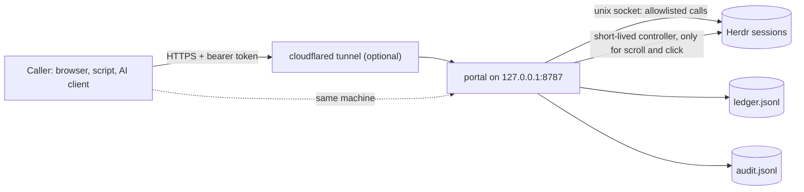

# instinct-herdr-tunnel

Read the whole chat of a coding agent, scroll its terminal and click inside it from a phone or an AI client, through a loopback portal in front of [Herdr](https://herdr.dev) with a fixed allowlist, a bearer token and an audit log. Built so an AI assistant such as [Instinct](https://instinct.com) can watch and nudge your coding agents; any client that can send an HTTPS request with a bearer token can use it.

    

Herdr's socket API has 102 request methods; some close panes, stop the server or run plugins. A phone or an AI client that needs to *see* your agents and *nudge* them should not hold that power, and by default it sees very little: the few rows of the visible screen, no scrollback, no way to move or click. The portal sits in front of Herdr and offers 26 actions, each with strict parameters. History reads, scroll and click are extra, **off until you switch them on**, and each is bound to what the caller actually saw. Writes are replay-safe and every change is on the record.

## See it hold the line

A blocked agent is waiting on a permission dialog. A remote caller tries to push it along. Abridged real output from a throwaway portal on the test suite's fake Herdr (no real pane; the same cases run in `npm test`):

```text
# 1. prompt a BLOCKED agent
{ "http": 409, "error": { "code": "blocked_requires_decision", "agent_status": "blocked" } }

# 2. answer its dialog with agent_decision (default config)
{ "http": 404, "error": { "code": "action_disabled" } }

# keys the fake Herdr received for those two calls
[]

# 3. prompt an IDLE agent
{ "http": 200, "status": "input_sent" }

# 4. audit trail (GET /api/herdr/audit_tail)
{"action":"herdr.agent_prompt","pane":"w1:p3","result":"rejected","http_status":409,"error_code":"blocked_requires_decision"}
{"action":"herdr.agent_prompt","pane":"w1:p2","result":"input_sent","http_status":200}
```

Dialogs stay with you: nothing reached the blocked agent, and the refusal is on the record.

## See it read, scroll and click on a real Herdr

`node scripts/e2e-control.js` starts its own Herdr server and portal in a temporary home, so it never touches your sessions, and drives them through the HTTP API. Output of the last run on Herdr 0.9.5, abridged:

```text
PASS  history: a plain shell returns far more than its screen, with the mode and the counts
PASS  host scrollback: two steps up moved the real offset by 6 lines and the screen changed
PASS  pane to bottom: offset 0 and the original screen is back
PASS  wheel scroll: three steps arrive as three wheel-up reports, with no position claimed and no resize
PASS  click: the exact cell arrives as a mouse press and release, the size was verified and nothing was resized
PASS  a click whose text is not under the cell is refused with the row as it is (409 screen_changed), nothing arrives
PASS  scrolling that agent pane is refused: read its history instead (409 use_history_read)
PASS  clicking it is refused until the owner enables agent clicks (409 agent_click_disabled)
PASS  scripts/e2e.js, including its write round trip, passes against the same disposable portal
ALL 19 STEPS PASSED on herdr 0.9.5
```

"Arrive" means a small program in the pane logged the bytes it received. What this run does *not* prove (a recognized agent paged by Herdr, which was checked once by hand, the owner typing during a click, a real Herdr on Linux) is listed in [docs/control.md](docs/control.md#not-covered).

## What you get

- 🔭 **The whole chat, not four rows.** `pane_read` with `source=recent_unwrapped` returns up to 2000 lines of a plain pane's scrollback, or the last 1000 rows of an idle agent's chat (Herdr 0.9.5 stops there; checked live on agents of the kinds claude, codex and droid), and says how complete it is (`history_mode`, `lines_returned`, `truncated`). "Nothing beyond the screen" is a typed answer (`409 history_unavailable` with the screen attached), never an empty success. *Proof:* `tests/history.test.js`.
- 🕹️ **Scroll and click, bound to what the caller saw.** `pane_scroll` moves Herdr's own scrollback or sends wheel events to a full-screen app; `pane_click` clicks one cell, only if the text the caller expects is still under it. Clicks on rows that look like a dialog choice or hold a confirm or refuse word (pattern matching, [not a guarantee](docs/control.md#click)), rows that cannot be mapped to a cell, and a terminal whose real size cannot be confirmed are refused with nothing sent. *Proof:* `tests/control.test.js`, `tests/click.test.js`, the live run above.
- 📨 **A follow-up for a working agent.** `agent_prompt` accepts a working agent and answers `input_sent_queued`: the prompt was delivered, and the agent's own interface decides whether it queues it or applies it at once. A blocked agent is still refused. *Proof:* `tests/prompt-queue.test.js`.
- 🧱 **An allowlist in front of the socket.** 26 actions ([API](docs/api.md)); unknown actions and parameters are refused. *Proof:* [docs/proof-matrix.md](docs/proof-matrix.md) checks every action against the installed Herdr schema and docs.
- 🔁 **Replay-safe writes, and a record.** Each write carries an idempotency key and its result goes into an fsync'd ledger that survives restarts. A timeout or crash between "maybe sent" and "recorded" becomes `needs_review` and is never retried by the portal. One JSON line per write in `audit.jsonl`, refusals included. *Proof:* the replay, concurrency, crash and audit tests.
- 🏷️ **See what it did, inside Herdr.** With `HERDR_PORTAL_TAG_PANES=1` the portal tags each pane it sends, or may have sent, input to (`prompt sent 14:07`) for Herdr's sidebar, and a small [Herdr plugin](docs/plugin.md) opens a live activity tab and narrows the Agents list to the agents it touched. Neither can send anything to a pane. *Proof:* `node scripts/e2e-plugin.js` against a real Herdr in a throwaway home.
- ⛔ **Dialogs stay with you, with one gap.** Every action refuses an agent that Herdr reports as blocked and sends nothing, and the one action that can answer a dialog, `agent_decision`, is off by default ([details](docs/agent-decision.md)). The gap: a prompt to a *working* agent is sent after a screen check, so a dialog in a shape the portal does not recognize, or one raised an instant before Herdr marks the agent blocked, can receive the text and its Enter ([residual risk](docs/security.md#residual-risks)). *Proof:* the refusal tests in `tests/portal.test.js` and `tests/prompt-queue.test.js`.

A browser page ships with it: the inventory, a live view of the selected pane that keeps its place while it updates, history with *Load more*, scroll buttons and a click mode.

## Quickstart

You need Node.js 22 or newer and [Herdr](https://herdr.dev/docs/install/) running (proven live on 0.9.5; newer versions are checked at run time, see Status). No npm dependencies. Developed and tested on macOS; the server uses only Node's standard library and Unix sockets. No real Herdr was run on Linux or Windows (CI runs the suite on Linux against fakes).

```sh
git clone https://github.com/romiluz13/instinct-herdr-tunnel.git && cd instinct-herdr-tunnel
npm test                   # the suite, against fakes; touches no real pane

# create the token (32 random bytes, file mode 0600, never printed; first time only, it replaces an existing one), then start the server
node -e 'require("./lib/config").ensureDirs(); require("./lib/security").createToken()'
HERDR_PORTAL_ENABLE_HISTORY=agents node server.js    # listens on 127.0.0.1:8787; `herdr` must be on PATH, or set HERDR_BIN
```

In a second terminal:

```sh
TOKEN=$(cat "$HOME/Library/Application Support/herdr-portal/secrets/portal-token")   # macOS default path
curl -s -H "Authorization: Bearer $TOKEN" http://127.0.0.1:8787/api/health
curl -s -H "Authorization: Bearer $TOKEN" "http://127.0.0.1:8787/api/herdr/agent_list?session=default"
```

Open `http://127.0.0.1:8787/` for the browser UI (sign in with the token). To keep it running, `bin/portalctl install` sets up a per-user LaunchAgent after checking everything first; to reach it from another device, see [the tunnel guide](docs/tunnel.md).

### For an AI client with a small window

```sh
# an agent pane: the whole chat, then the live screen (history is on in the command above)
curl -s -H "Authorization: Bearer $TOKEN" "http://127.0.0.1:8787/api/herdr/pane_read?session=default&pane_id=w1:p2&source=recent_unwrapped&lines=2000"
curl -s -H "Authorization: Bearer $TOKEN" "http://127.0.0.1:8787/api/herdr/pane_read?session=default&pane_id=w1:p2&source=visible"
```

Scroll and click need `HERDR_PORTAL_ENABLE_CONTROL=1` and are writes, so they take the [write envelope](docs/api.md#writes). Read [docs/control.md](docs/control.md) before you turn them on.

## How it fits together



## Docs

| | |
|---|---|
| [API reference](docs/api.md) | endpoints, the 26 actions, errors, write semantics |
| [For an AI assistant](docs/client-guide.md) | connect, see, act and check, in order |
| [Control: history, scroll, click](docs/control.md) | the model, the limits, what was not measured |
| [Herdr plugin and pane tag](docs/plugin.md) | install, the sidebar row, what it can and cannot do |
| [Security model](docs/security.md) | what the token can do, what is and is not protected |
| [Configuration and service](docs/configuration.md) | environment variables, `portalctl`, a second instance |
| [Reaching it remotely](docs/tunnel.md) | Cloudflare Quick Tunnel, a named tunnel, Access in front |
| [`agent_decision`](docs/agent-decision.md) | the one action that answers a dialog, and why it is off |
| [Proof matrix](docs/proof-matrix.md) · [Tests](docs/development.md) | how each claim is checked |
| [Glossary](GLOSSARY.md) · [Changelog](CHANGELOG.md) | the words this project uses, and what changed |

## Status

**Alpha.** One maintainer, one tested environment.

- **Future Herdr versions are checked, not assumed.** The portal reads the installed `herdr api schema --json` and, per action, refuses a write (`503 contract_mismatch`, nothing sent) when a method or CLI subcommand it relies on is gone, or a parameter or new required field of the calls it forwards by name changed. Every write also confirms the target server runs the build that was checked. This compares request parameter names and required fields only: not types, enums, response fields or what a call now means. Live testing covered Herdr 0.9.5 only; `GET /api/health` shows `contract.verified_live`, and `HERDR_PORTAL_STRICT_VERSION=1` restricts writes to the proven version.
- **Not proven:** a recognized agent paged by Herdr in a script (it was read once by hand on live claude, codex and droid agents), the owner typing while a click is delivered, a real Herdr on Linux (CI runs the suite there against fakes), assistive technology, and the browser page outside one headless Chrome 156 run (layout, tap, wheel and click were checked there at phone and desktop sizes; the rest of the page is tested in a small DOM against a real portal).
- **No rotation** of `audit.jsonl` or `ledger.jsonl`; both only grow.
- **Remote (SSH) Herdr machines are not covered.**

Issues and pull requests are welcome: see [CONTRIBUTING](CONTRIBUTING.md) and the [code of conduct](CODE_OF_CONDUCT.md). To report a vulnerability, see [SECURITY](SECURITY.md).

## License

[MIT](LICENSE) © 2026 Rom Iluz

This is an independent community project. It is not affiliated with, endorsed by or sponsored by Instinct or Herdr; both names belong to their owners.
