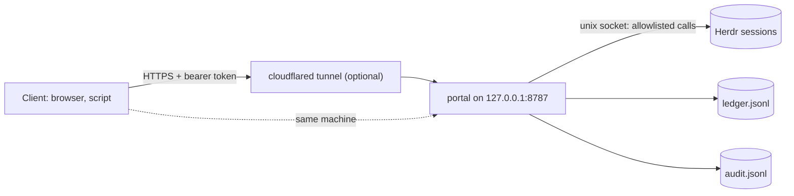

# instinct-herdr-tunnel

Watch every local [Herdr](https://herdr.dev) session and steer its coding agents from your phone or another machine, through a loopback HTTP portal with a fixed allowlist, a bearer token and an audit log.

    

Herdr's socket API has 102 request methods; some close panes, stop the server or run plugins. A script or a phone that only needs to *see* your agents and *nudge* them should not hold that power. The portal sits in front of Herdr and offers 24 actions, each with strict parameters; the 20 that call Herdr are mapped to specific Herdr calls and checked against the installed schema and Herdr's documentation. One more, `put_file`, drops a text file into a single directory. Writes are replay-safe and every change is on the record.

## See it hold the line

A blocked agent is waiting on a permission dialog. A remote caller tries to push it along. Abridged real output from a throwaway portal on the test suite's fake Herdr (no real pane; the same cases run in `npm test`):

```text
# 1. prompt a BLOCKED agent
{ "http": 409, "error": { "code": "blocked_requires_decision", "agent_status": "blocked" } }

# 2. answer its dialog with agent_decision (default config)
{ "http": 404, "error": { "code": "action_disabled" } }

# keys the fake Herdr received for those two calls
[]

# 3. prompt an IDLE agent
{ "http": 200, "status": "input_sent" }

# 4. audit trail (GET /api/herdr/audit_tail)
{"action":"herdr.agent_prompt","pane":"w1:p3","result":"rejected","http_status":409,"error_code":"blocked_requires_decision"}
{"action":"herdr.agent_prompt","pane":"w1:p2","result":"input_sent","http_status":200}
```

Dialogs stay with you: nothing reached the blocked agent, and the refusal is on the record.

## What you get

- 🔭 **One view of every session.** `GET /api/inventory` lists all running local Herdr sessions with workspaces, tabs, panes and agent status. Data counts as stale from first sight and after any event-stream loss, until a fresh snapshot succeeds; an unreachable session shows up as a gap, never as an empty one. *Proof:* `tests/inventory.test.js`.
- 🧱 **An allowlist in front of the socket.** 24 actions ([API](docs/api.md)); unknown actions, unknown parameters and the pane read sources that can scroll a full-screen agent are refused. *Proof:* [docs/proof-matrix.md](docs/proof-matrix.md) checks every action against the installed Herdr schema and docs.
- 🔁 **Replay-safe writes.** Each write carries an idempotency key and its result goes into an fsync'd ledger that survives restarts. A timeout or crash between "maybe sent" and "recorded" becomes `needs_review` and is never retried by the portal. *Proof:* the replay, concurrency and crash tests.
- ⛔ **Dialogs stay with you.** Every action refuses a blocked agent and sends nothing. The one action that can answer a dialog, `agent_decision`, is off by default; enabling it is an operator choice with known residual risks ([details](docs/agent-decision.md)). *Proof:* the refusal tests in `tests/portal.test.js`.
- 📥 **A guarded file drop.** `put_file` writes one UTF-8 file (up to 256 KiB) into one directory and answers with the size and SHA-256 read back from disk. Paths are checked name by name, symlinks are refused, the write is temp file, `fsync`, atomic publish, mode 0600, and it never waits on Herdr. *Proof:* `tests/put-file.test.js`, [API](docs/api.md#put_file).
- 📜 **An audit trail.** One JSON line per manage action and per `put_file` call, refusals included, in `audit.jsonl`. *Proof:* the audit tests in `tests/portal.test.js`.

## Quickstart

You need Node.js 22 or newer and [Herdr](https://herdr.dev/docs/install/) running (proven live on 0.9.3; newer versions are checked at run time, see Status). No npm dependencies. Developed and tested on macOS; the server uses only Node's standard library and Unix sockets, but nothing here was run on Linux or Windows.

```sh
git clone https://github.com/romiluz13/instinct-herdr-tunnel.git && cd instinct-herdr-tunnel
npm test                   # 102 tests against fakes; touches no real pane

# create the token (32 random bytes, file mode 0600, never printed), then start the server
node -e 'require("./lib/config").ensureDirs(); require("./lib/security").createToken()'
node server.js             # listens on 127.0.0.1:8787; `herdr` must be on PATH, or set HERDR_BIN
```

In a second terminal:

```sh
TOKEN=$(cat "$HOME/Library/Application Support/herdr-portal/secrets/portal-token")   # macOS default path
curl -s -H "Authorization: Bearer $TOKEN" http://127.0.0.1:8787/api/health
curl -s -H "Authorization: Bearer $TOKEN" "http://127.0.0.1:8787/api/herdr/agent_list?session=default"
```

Open `http://127.0.0.1:8787/` for the browser UI (inventory, pane reads, prompts, keys; sign in with the token). To keep it running, `bin/portalctl install` sets up a per-user LaunchAgent after checking everything first; to reach it from another device, see [the tunnel guide](docs/tunnel.md).

## How it fits together



## Docs

| | |
|---|---|
| [API reference](docs/api.md) | endpoints, the 24 actions, errors, write semantics |
| [Security model](docs/security.md) | what the token can do, what is and is not protected |
| [Configuration and service](docs/configuration.md) | environment variables, `portalctl`, a second instance |
| [Reaching it remotely](docs/tunnel.md) | Cloudflare Quick Tunnel and a named tunnel |
| [`agent_decision`](docs/agent-decision.md) | the one action that answers a dialog, and why it is off |
| [Proof matrix](docs/proof-matrix.md) · [Tests](docs/development.md) | how each claim is checked |

## Status

**Alpha.** One maintainer, one tested environment.

- **Future Herdr versions are checked, not assumed.** The portal reads the installed `herdr api schema --json` and, per action, refuses a write (`503 contract_mismatch`, nothing sent) when a method, CLI subcommand or parameter it relies on is gone or a new required field appeared. Every write also confirms the target server runs the build that was checked. This compares request parameter names and required fields only: not types, enums, response fields or what a call now means. Live testing covered Herdr 0.9.3 only; `GET /api/health` shows `contract.verified_live`, and `HERDR_PORTAL_STRICT_VERSION=1` restricts writes to the proven version. Herdr 0.9.4 passes the contract check for all 23 actions.
- **No rotation** of `audit.jsonl` or `ledger.jsonl`; both only grow.
- **Remote (SSH) Herdr machines are not covered.**

Issues and pull requests are welcome: see [CONTRIBUTING](CONTRIBUTING.md). To report a vulnerability, see [SECURITY](SECURITY.md).

## License

[MIT](LICENSE) © 2026 Rom Iluz
